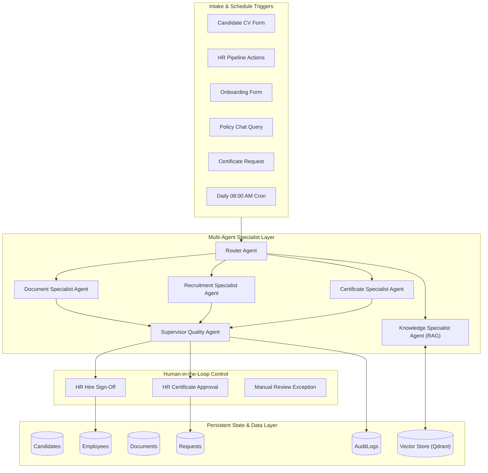

# Smart HR Operations Hub
### AI-Powered Employee Lifecycle Automation • Module 6 Expanded Capstone Assignment

**Fictional Enterprise:** NexusCore Technologies  
**Target Platform:** n8n Workflow Automation Platform + AI Multi-Agent Network  
**Evaluation Standard:** 100-Point Comprehensive Rubric (Workflows 1–6, Multi-Agent Architecture, RAG Ingestion, OCR & Blurriness Detection, Human-in-the-Loop Governance, Acceptance Tests T01–T18).

---

## 1. System Overview & Architecture

The **Smart HR Operations Hub** is an integrated educational automation system designed to eliminate fragmented, manual HR operations across the entire employee lifecycle:
1. **CV Intake & AI Extraction:** Captures resumes via web intake, parses multimodal inputs (PDF/scanned images), extracts validated fields without hallucinations, and creates traceable candidate records.
2. **Recruitment Pipeline & Review:** Compares applicant credentials against technical Job Descriptions, calculates match percentages and gaps with explicit CV citations, while enforcing **Human HR Reviewer authority** on all hiring decisions.
3. **Employee Onboarding & OCR:** Triggers upon HR confirmation of a hire, opening a multi-document checklist (mock national IDs, contracts, degrees), performing OCR, and flagging blurry/unreadable scans for manual inspection.
4. **HR Policy Assistant (RAG):** Answers employee inquiries grounded strictly in versioned corporate HR policies with exact citations `[Source, Section, Version]` and safely abstains from unindexed topics.
5. **HR-Approved Experience Certificates:** Verifies employment tenure, drafts branded certificate templates, requires digital HR authorization, and issues tamper-evident PDF certificates.
6. **Operations Monitoring & Recovery:** Executes scheduled daily sweeps, aggregates HR operational metrics, and automatically recovers transient errors within bounded retries while enforcing idempotency.



---

## 2. Directory Structure

```text
Smart_HR_Operations_Hub/
├── workflows/                          # Core n8n Workflow JSON exports
│   ├── 01_CV_Intake_and_Extraction.json
│   ├── 02_Recruitment_Pipeline.json
│   ├── 03_Onboarding_and_OCR.json
│   ├── 04_HR_Policy_Assistant_RAG.json
│   ├── 05_Certificate_Generation.json
│   └── 06_Operations_Monitoring_Recovery.json
├── data/                               # Persistent Records / CSV Schemas
│   ├── Jobs.csv                        # Fictional Job Postings (JD-101, JD-102, JD-103)
│   ├── Candidates.csv                  # Candidate tracking & stage management
│   ├── Employees.csv                   # Master records for 6 fictional employees
│   ├── Documents.csv                   # Onboarding document checklist & OCR status
│   ├── Requests.csv                    # Formal HR requests & approval tracking
│   └── AuditLogs.csv                   # Immutable audit log with timestamp & actors
├── synthetic_dataset/                  # Comprehensive Demo Package
│   ├── resumes/                        # 10 Synthetic CVs (Text PDFs, Scans, Incomplete)
│   ├── job_descriptions/               # 3 Detailed technical Job Descriptions
│   ├── id_mockups/                     # 4 Synthetic ID cards (Clear + Blurry/Unreadable)
│   ├── onboarding_docs/                # Sample employment contracts & university degrees
│   └── hr_policies/                    # 4 HR Policies in Markdown (v1.0 & v1.1 update)
├── templates/                          # Branded Certificate Assets
│   ├── certificate_template.html       # Branded HTML/CSS template with placeholders
│   ├── certificate_engine.py           # Tamper-evident PDF rendering engine
│   └── sample_experience_certificate.pdf # Pre-rendered demonstration certificate
├── architecture/                       # System Specifications & Diagrams
│   ├── agent_specifications.md         # Prompts, boundary rules & JSON contracts
│   └── system_architecture.md          # Data flow & state transition architecture
├── test_evidence/                      # Verification Traces
│   └── test_matrix_results.md          # Verified results for T01 through T18
├── simulator/                          # Local Execution & Testing Engine
│   ├── hr_hub_engine.py                # Standalone simulation engine
│   └── run_acceptance_tests.py         # Automated runner for T01 - T18 test cases
├── README.md                           # Master Project Documentation (English)
├── STUDENT_ARABIC_GUIDE.md             # Complete step-by-step student guide (Arabic)
└── TEAM_RESPONSIBILITY.md              # Capstone team ownership document
```

---

## 3. How to Run the Project

### Method A: Interactive Bilingual Web GUI Portal (Recommended for Evaluation & Live Demo)
We have developed an enterprise-grade, responsive, bilingual (Arabic & English) Web Portal enabling full interactive execution of all 6 workflows:

1. **One-Click Launch on Windows:**
   - Double-click START_PORTAL.bat in the project root directory.
   - Or run in terminal:
     `powershell
     python run_portal.py
     `
2. The web browser opens automatically at http://127.0.0.1:8000.
3. Toggle between **English** and **العربية** with the top-right language button (includes automatic RTL/LTR layout and bilingual AI answers).

---

### Method B: Standalone Acceptance Test Suite Runner (T01 - T18)
You can run and verify the entire system, all 6 workflows, multi-agent logic, RAG retrieval, and the complete T01–T18 test suite locally using Python without needing external cloud credentials:

1. Open your terminal in the workspace directory.
2. Execute the automated test suite:
   ```powershell
   python Smart_HR_Operations_Hub/simulator/run_acceptance_tests.py
   ```
3. Observe all 18 acceptance criteria passing with detailed trace outputs.
4. Review the generated report at `Smart_HR_Operations_Hub/test_evidence/test_matrix_results.md`.

---

### Method C: Importing Workflows into n8n

To run or inspect the workflows inside your self-hosted or cloud n8n instance:

1. **Launch n8n:**
   If running n8n locally via npm/npx:
   ```bash
   npx n8n
   ```
   Open `http://localhost:5678` in your browser.

2. **Import Workflow JSONs:**
   - In n8n, click **Workflows** > **Add Workflow** > **... (top right menu)** > **Import from File**.
   - Navigate to `Smart_HR_Operations_Hub/workflows/` and select each workflow:
     - `01_CV_Intake_and_Extraction.json`
     - `02_Recruitment_Pipeline.json`
     - `03_Onboarding_and_OCR.json`
     - `04_HR_Policy_Assistant_RAG.json`
     - `05_Certificate_Generation.json`
     - `06_Operations_Monitoring_Recovery.json`

3. **Configure Credentials (Evaluator Notice):**
   In compliance with the project guidelines, **zero secrets or live API keys are stored in the JSON files**.
   Connect your own credentials in n8n for:
   - **LLM Model Provider:** OpenAI, Google Gemini, or Anthropic (for LangChain Agent nodes).
   - **Google Sheets:** To connect with `Candidates`, `Employees`, and `Requests` spreadsheets.
   - **Gmail:** For HR notifications and candidate emails.
   - **Qdrant / Vector Store:** For dense embedding retrieval in Workflow 4.

### Method D: Vercel Deployment with Persistent Data

The local simulator stores its records in CSV files. Vercel functions do not
provide durable writable storage, so configure a PostgreSQL database before
using the portal for records that must survive deployments or cold starts.

1. Create a PostgreSQL database with a provider such as Neon or Supabase.
2. In Vercel, add its connection string as the `DATABASE_URL` environment
   variable for Production (and Preview if needed). Do not commit the URL or
   place it in frontend code.
3. Redeploy the project, then check `/api/health`. It should report
   `"storage": "postgresql"`.

On its first database connection, the app creates its tables and inserts
fictional demo records only. It does not import the repository's CSV files or
their local paths. Without `DATABASE_URL`, the portal continues to use local
CSV storage and reports `"storage": "local_csv"`; that mode is for local demos,
not durable Vercel data.
Approved certificate PDFs are also stored in PostgreSQL so their download links
continue to work across serverless instances.

The acceptance-test runner resets local CSV data, so it is blocked when
`DATABASE_URL` is set. Run the tests locally with that variable unset.

---

## 4. Acceptance Testing Matrix (T01 – T18)

Every test scenario mandated in Sections 09 & 10 of the capstone brief is verified:

| Test ID | Test Case | Target Workflow | Expected Result | Status |
| :---: | :--- | :---: | :--- | :---: |
| **T01** | Submit text-based CV | Workflow 1 | Validated candidate record created; HR notified once | ✅ PASS |
| **T02** | Submit image-only CV | Workflow 1 | OCR/vision extracts known fields; uncertainty flagged | ✅ PASS |
| **T03** | Submit incomplete CV | Workflow 1 | No invented values; manual review state recorded | ✅ PASS |
| **T04** | Repeat same application | Workflow 2 | Duplicate flagged; secondary alert suppressed | ✅ PASS |
| **T05** | Compare CV with job | Workflow 2 | Explainable gap analysis; no autonomous rejection | ✅ PASS |
| **T06** | HR changes stage to Hired | Workflows 2 & 3 | Exactly one employee record created; onboarding begins | ✅ PASS |
| **T07** | Upload missing onboarding file | Workflow 3 | Checklist shows missing item; HR alerted | ✅ PASS |
| **T08** | Upload blurry synthetic ID | Workflow 3 | Identity verification prevented; flagged for manual review | ✅ PASS |
| **T09** | Ask question covered by policy | Workflow 4 | Grounded answer with source file, section, and version | ✅ PASS |
| **T10** | Ask unsupported policy query | Workflow 4 | Assistant transparently abstains and refers to HR | ✅ PASS |
| **T11** | Update an indexed policy | Workflow 4 | Stale chunks invalidated; answer reflects new v1.1 rules | ✅ PASS |
| **T12** | Approve valid certificate request | Workflow 5 | Exactly one branded PDF issued with restricted link | ✅ PASS |
| **T13** | Reject certificate approval | Workflow 5 | Rejection recorded; no PDF generated | ✅ PASS |
| **T14** | Certificate with unknown employee ID | Workflow 5 | Request blocked; flagged for HR security audit | ✅ PASS |
| **T15** | Run daily HR schedule | Workflow 6 | Operational digest compiled with accurate counts | ✅ PASS |
| **T16** | Repeat approved certificate request | Workflow 5 | Idempotent execution; no duplicate PDF or delivery | ✅ PASS |
| **T17** | Simulate transient API failure | Workflow 6 | Bounded retries (<= 3); outcome logged safely | ✅ PASS |
| **T18** | Run scheduled catch-up | Workflow 6 | Backdated unhandled request identified and processed once | ✅ PASS |

---

## 5. Live Demonstration Sequence (10–12 Minutes)

When presenting to evaluators, follow this recommended sequence:

1. **Step 1 (Recruitment - 2 mins):** Submit `CV01_Tariq_Al_Mansoor.pdf`. Show the extracted JSON in `Candidates.csv` and the single HR notification alert. Show skill matching against `JD-101`.
2. **Step 2 (Human Approval & Onboarding - 2 mins):** Set stage to `Hired` as HR Reviewer Sarah Nabil. Show the new employee profile (`EMP-2026-xxx`) created.
3. **Step 3 (OCR & Blurriness Exception - 2 mins):** Upload `ID_004_Blurry_Unreadable.png`. Demonstrate that the system detects degraded scan quality, marks `review_status: Needs Review`, and alerts HR instead of falsely authenticating identity.
4. **Step 4 (RAG Policy Assistant - 2 mins):** Ask annual leave entitlement (`Leave_Policy_v1.0.md`). Show the citation `[Source: Leave_Policy_v1.0.md, Section: Section 1, Version: 1.0]`. Demonstrate query update after policy revision to v1.1 (`General_HR_Policy_v1.1.md`).
5. **Step 5 (Experience Certificate - 2 mins):** Submit certificate request for `EMP-005` (eligible former engineer). HR approves -> Show generated PDF `CERT-2026-xxxx.pdf` with company branding, authorized signature, and verification hash. Show rejection of `EMP-001` generates 0 PDFs.
6. **Step 6 (Monitoring & Recovery - 2 mins):** Trigger the daily 08:00 AM sweep. Show the aggregated HR metrics digest and demonstrate idempotent handling of a duplicate certificate trigger (T16).

---

## 6. Security, Governance & Compliance Rules

1. **Synthetic Data Standard:** All employee names, email addresses, national IDs, and contracts are 100% fictional. No real PII or genuine government documents are used.
2. **Untrusted Uploads:** Uploaded CVs and policies are treated as untrusted user input; prompt isolation prevents prompt injection attacks.
3. **Zero Secrets in JSON:** All workflow exports omit credentials, ensuring safety during repository check-in and evaluation.
