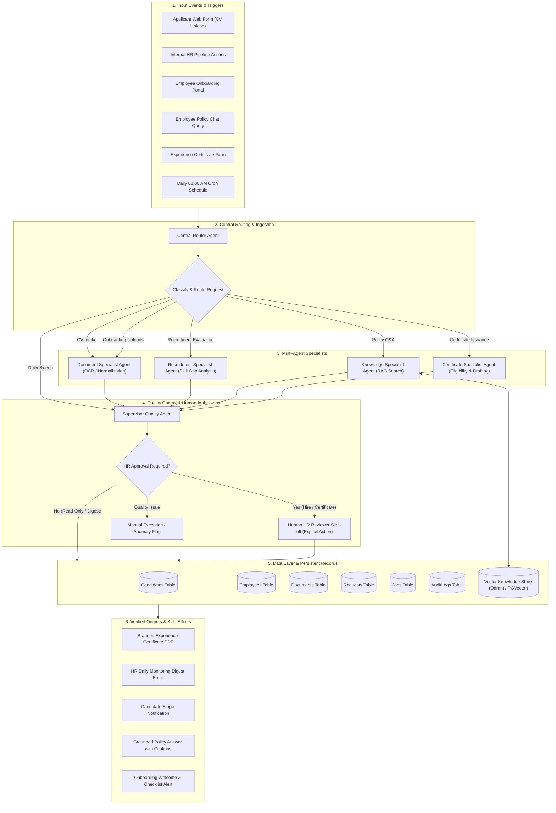

# System Architecture & Data Flow
**Project:** Smart HR Operations Hub  
**Platform:** n8n Workflow Automation Platform + AI Multi-Agent Network  

---

## 1. High-Level Architecture Diagram (Mermaid)

---

## 2. Shared State & Request Life Cycle

Each event throughout the system adheres to a unified transaction schema:
- `request_id`: Deterministic UUID or formatted ID (e.g. `REQ-2026-0842`) to enforce idempotency.
- `actor_role`: Identity classification (`Applicant`, `Employee`, `HR_Manager`, `System`).
- `request_type`: Specific operational domain (`CV_INTAKE`, `RECRUITMENT`, `ONBOARDING`, `POLICY_RAG`, `CERTIFICATE`, `MONITORING`).
- `status`: Discrete lifecycle stage (`RECEIVED`, `EXTRACTED`, `PENDING_HR_APPROVAL`, `APPROVED`, `REJECTED`, `FAILED`, `COMPLETED`).
- `owner`: Assigned stakeholder or automated specialist agent.
- `next_action`: Clear subsequent step in the business process.
- `audit_timestamp`: ISO 8601 UTC timestamp tracking every mutation in `AuditLogs`.

---

## 3. Human-in-the-Loop Control Guarantees

As enforced by the project brief:
1. **Recruitment:** An applicant cannot be transitioned to `Hired` without an authorized HR officer recording the decision.
2. **Onboarding:** Uploaded national IDs and contracts undergo OCR validation, but authentication decisions require HR verification. Blurry images automatically transition to `Needs Review`.
3. **Certificates:** AI agents extract records and draft templates, but `PDF_GENERATION` and release links are strictly locked until an authorized manager executes an approval webhook.
